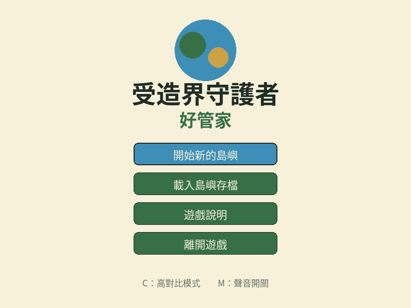
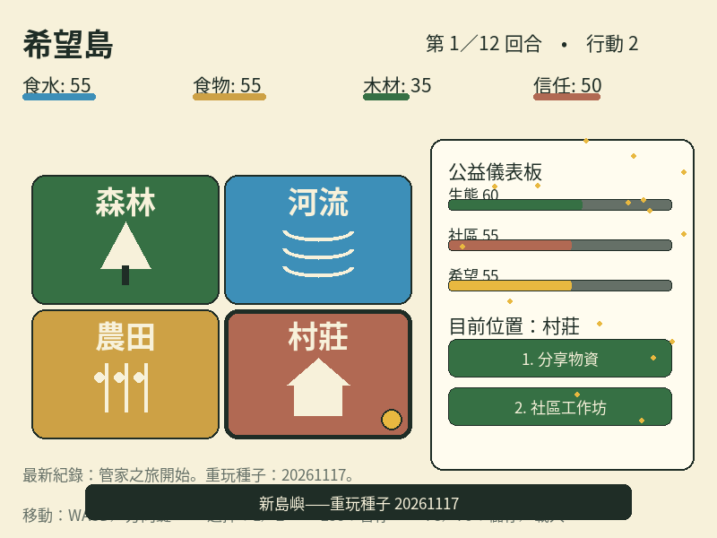
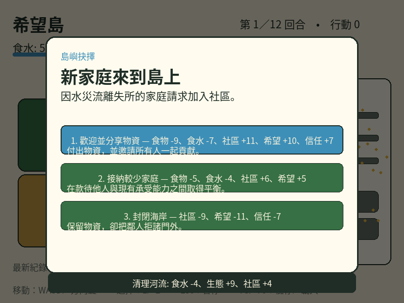

# 專題基本資料

| 項目 | 內容 |
|---|---|
| 專題名稱 | 《受造界守護者》（Guardians of Creation） |
| 指定主題 | 好管家——受造界守護者（The Good Steward: Guardians of Creation） |
| 組員 | 學生一：____________　學生二：____________ |
| 班別／組別 | ____________ |
| 開發期 | 2026 年 11 月 3–24 日 |
| 最終截止 | 2026 年 11 月 24 日 23:59 |
| 平台 | Python 3.11–3.13、Pygame CE 2.5.6 |
| 目標系統 | macOS、Windows、Linux；安裝後完全離線運行 |
| 程式庫 | https://github.com/jasonchongcnh/F6-ICT |
| 文件狀態 | 最終「按成品核實」版本；學生須核實姓名及真人證據 |

> **誠信聲明：**本計劃書整合已完成遊戲的可驗證技術資料。OpenAI Codex 曾協助建立程式、測試、翻譯及文件；相關使用已在 AI 使用紀錄申報。學生必須親自審閱並能解釋所有內容。沒有提供的真人會議、貢獻、試玩或簽署證據不會被虛構或倒填。

# 1. 執行摘要

《受造界守護者》是一款以希望島為舞台的回合制資源管理遊戲。玩家是一位年輕管家，受託照顧島上的森林、河流、農田和村莊。在十二個回合內，玩家每回合只有兩次行動，必須在食水、食物、木材及社區信任等短期需要，與生態、社區福祉及希望等長期價值之間作出取捨。

遊戲的宗教／正面價值不是附加在開始畫面的標語，而是直接存在於規則之中。分享物資會付出眼前成本，卻能建立團結與希望；過度開發能快速增加資源，卻會造成污染和延後損失；保護濕地或恢復生物多樣性需要現在犧牲，回報則在日後出現。最高「忠信的好管家」結局要求各項價值及基本資源保持平衡，不能只最大化一項分數。

成品採用資料驅動事件、固定隨機種子、JSON 存檔、五種結局、鍵盤／滑鼠操作、高對比模式、跨平台中文字型及程序化音效。模型與介面分離，令規則可以在沒有視窗的情況下測試。最終版通過 24 項自動測試，並完成 1,000 場固定種子平衡模擬。

# 2. 問題、機會與設計理據

## 2.1 設計問題

指定主題要求學生表達管家職分、公益、團結、明智和公義。若遊戲只在開始畫面加入十字架、金句或環保口號，玩家並不需要在實際玩法中運用這些價值。因此核心設計問題是：

> 如何把「關愛受造界及鄰人」轉化為玩家必須理解、權衡和承擔後果的遊戲系統？

## 2.2 設計機會

回合制管理遊戲適合此主題，因為玩家可以看見有限資源、比較多個方案、承受延後後果並反思結果。與射擊或迷宮遊戲相比，資源管理更能表達短期利益和長期公益之間的張力。

## 2.3 建議解決方案

- 把森林、河流、農田和社區設為四個互相依賴的區域。
- 每回合限制兩次行動，迫使玩家排序需要。
- 同時追蹤可消耗資源和不可忽略的公共價值。
- 以九個事件提供兩至三個有意義選項。
- 使用延後效果表達環境決定的長遠影響。
- 以多結局評估整體平衡，而非單一最高分。
- 顯示數值變化，令因果關係容易學習、測試及答辯。

# 3. 目標玩家及使用情境

## 3.1 目標玩家

主要對象為 15–18 歲學生。他們熟悉鍵盤、滑鼠和基本遊戲規則，但未必熟悉複雜經濟模擬。因此遊戲需要清楚顯示資源、選項和後果，並把一場完整遊戲控制在課堂可示範的範圍內。

## 3.2 玩家需要

- 無需長篇教學即可理解核心任務。
- 同時支援鍵盤和滑鼠。
- 文字、按鈕和數值在 800×600 畫面清晰可讀。
- 可暫停、重開、儲存和載入。
- 不依賴網絡或外部帳戶。
- 相同種子可重現相同事件次序，方便公平比較。

## 3.3 無障礙考慮

- `C` 切換高對比模式。
- `M` 切換聲音；沒有音訊裝置時自動靜音，不阻止遊戲。
- 顏色之外亦使用文字和數字傳達狀態。
- 鍵盤及滑鼠提供等效主要操作。
- 繁體中文使用 macOS PingFang、Windows 微軟正黑體或 Linux Noto CJK 的實際字型路徑，避免方格字。

# 4. 學習目標

本專題預期展示以下知識與能力：

1. 建立穩定的 Pygame 主循環、事件處理和 60 FPS 畫面更新。
2. 使用場景／狀態管理處理主選單、說明、遊戲、事件、暫停及結局。
3. 實作資源管理、數值限制、延後效果和多結局。
4. 以 JSON 建立資料驅動事件，並驗證外部資料。
5. 實作版本化存檔、原子式寫入和錯誤處理。
6. 分離介面與模型，以自動測試驗證遊戲規則。
7. 使用固定種子及大量模擬分析平衡。
8. 以 Git 提交、工程筆記、錯誤紀錄、測試數據及影片建立可驗證過程。
9. 把管家職分、公益、團結、明智及公義準確融入玩法。
10. 在答辯中解釋程式、架構、取捨、測試限制及 AI 協助。

# 5. 研究、競品及取捨分析

| 參考作品 | 可借鑑之處 | 不直接採用的原因 | 本專題決定 |
|---|---|---|---|
| *Reigns* | 簡短事件卡令選擇及後果容易理解 | 單純二選一可能掩蓋系統深度 | 使用事件卡，但顯示實際資源／價值效果，部分事件有三個選項 |
| *Mini Metro* | 清晰視覺語言及互相影響的簡單系統 | 即時壓力可能減少道德反思時間 | 採用平靜回合制、圖示化區域及清楚儀表板 |
| *Frostpunk* | 道德抉擇與生存、社區管理緊密結合 | 氣氛、內容及系統對目標年齡過重 | 保留有代價的選擇，改用適齡、正面及有希望的敘事 |

## 5.1 主要技術取捨

| 決定 | 優點 | 代價／限制 |
|---|---|---|
| 回合制而非限時 | 容易反思、測試、存檔及照顧無障礙 | 動作感較低 |
| 顯示數值效果 | 因果清晰，方便學習、測試和答辯 | 減少神秘感 |
| JSON 事件 | 容易修改內容和平衡 | 必須加入資料驗證 |
| 固定種子 | 保留變化，同時可重現錯誤 | 玩家可能分享特定種子路線 |
| 程式生成圖像／音效 | 原創、離線、授權清晰 | 視覺細節不及外部素材 |
| 系統 CJK 字型 | 不需重新分發大型字型檔 | 必須處理各作業系統路徑 |

# 6. 世界觀、敘事及主題詮釋

希望島是一個小型社區，居民依賴森林提供木材、河流提供食水、農田提供糧食、村莊維持互信。玩家不是島嶼的擁有者，而是受託照顧共同恩賜的管家。

| 核心價值 | 遊戲中的表達方式 |
|---|---|
| 關愛受造界 | 種植原生樹木、清理河流、恢復生物多樣性、保護濕地 |
| 公益 | 結局同時檢查生態、社區、希望及基本資源 |
| 團結 | 分享物資、協助失火家庭、接納流離失所者 |
| 明智 | 比較即時收益、延後傷害及有限行動 |
| 公義 | 公平分水、按需要分享收成、拒絕排除鄰人的私人利益 |
| 希望 | 即使失敗，疏忽結局仍鼓勵反思及重新開始 |

# 7. 遊戲規格

## 7.1 核心規則

- 遊戲共十二個回合。
- 每回合開始時有兩次行動。
- 玩家移動至四個區域之一，選擇該區兩項行動之一。
- 第二次行動後出現事件卡。
- 事件有二至三個選項，改變資源及價值；部分效果延後二至三回合。
- 每個新回合會消耗食物和食水；低生態會增加食水消耗。
- 生態、社區或希望跌至零，遊戲提前以疏忽結局結束。
- 十二回合後，系統按整體狀態選擇五種結局之一。

## 7.2 核心循環

```text
查看資源與公益儀表板
        ↓
移動到森林／河流／農田／村莊
        ↓
執行兩次有限行動
        ↓
處理事件抉擇
        ↓
套用即時及到期的延後效果
        ↓
消耗社區日常需要並進入下一回合
        ↓
十二回合後評估結局
```

## 7.3 資源與價值

| 名稱 | 類型 | 初始值 | 作用 |
|---|---|---:|---|
| 食水 | 可消耗資源 | 55 | 每回合消耗；乾旱、污染及保護措施會影響 |
| 食物 | 可消耗資源 | 55 | 每回合消耗；農耕、分享及事件會影響 |
| 木材 | 可消耗資源 | 35 | 建設、分享、修復及風暴防護所需 |
| 信任 | 社會資源 | 50 | 反映居民對公平決定的信心 |
| 生態 | 核心價值 | 60 | 影響水循環、結局及崩潰風險 |
| 社區 | 核心價值 | 55 | 反映公益、團結及共同生活 |
| 希望 | 核心價值 | 55 | 反映居民面對困難的信念及未來感 |

所有數值限制於 0–100，避免儀表板及結局邏輯出現無效狀態。

## 7.4 四個區域與行動

| 區域 | 行動一 | 行動二 | 主要取捨 |
|---|---|---|---|
| 森林 | 適量伐木 | 種植原生樹木 | 木材即時收益對生態及長遠修復 |
| 河流 | 收集食水 | 清理河流 | 食水儲備對生態與社區 |
| 農田 | 收割農作物 | 再生農耕 | 食物即時收益對土壤及希望 |
| 村莊 | 分享物資 | 社區工作坊 | 食物／木材成本對社區、信任及希望 |

## 7.5 事件系統

事件儲存在 `data/events.json`，程式驗證唯一 ID、選項數量、合法數值及延後效果。

| 事件 | 抉擇例子 | 主題意義 |
|---|---|---|
| 久旱無雨 | 公平分水、保護濕地、出售私人取水權 | 公義、明智及共同資源 |
| 工廠的提議 | 無限制接受、要求潔淨方法、成立合作社 | 短期利益、環境責任及共同工作 |
| 鄰居家中失火 | 合力重建、臨時安置、保留自己儲備 | 團結與犧牲 |
| 森林蟲害 | 強力農藥、恢復生物多樣性 | 即時控制與自然修復 |
| 豐收有餘 | 按需要分享、保存種子、最高價出售 | 分配公義及未來準備 |
| 風暴迫近 | 保護脆弱家庭、鞏固河岸、保護倉庫 | 優先照顧弱小者 |
| 新家庭來到島上 | 歡迎分享、有限接納、封閉海岸 | 款待、能力及團結 |
| 寧靜的泉源 | 共享保護區、裝瓶出售 | 共同恩賜與私有利益 |
| 議會分歧 | 聆聽會議、農田優先、棲息地優先 | 對話、公平及平衡 |

## 7.6 多結局

| 結局 | 主要條件及訊息 |
|---|---|
| 忠信的好管家 | 三項核心價值均高、差距有限，食物及食水充足；表達平衡管家職分 |
| 團結共融的社區 | 信任、社區及希望突出，同時維持基本生態及生活需要 |
| 重現生機的島嶼 | 生態修復突出，社區仍可維持；提醒下一步要公平分享 |
| 短期利益的代價 | 儲備豐厚，但生態或社區受損；批判沒有公義的繁榮 |
| 重新出發的召喚 | 核心價值崩潰或整體不足；鼓勵反思、重玩及尋找平衡 |

# 8. 介面與玩家體驗

{width=75%}

主選單提供新遊戲、載入、遊戲說明和離開。玩家可在任何主要畫面使用 `C` 切換高對比、`M` 切換聲音。

{width=85%}

遊戲畫面左側為四區地圖及玩家標記，右側為公益儀表板和行動按鈕。頂部顯示四項資源、回合及剩餘行動，底部顯示最新紀錄及快捷鍵。

{width=85%}

事件卡以標題、敘事、選項、即時數值和簡短說明呈現取捨。鍵盤數字、方向鍵、Enter 或滑鼠均可操作。

## 8.1 控制

| 輸入 | 功能 |
|---|---|
| WASD／方向鍵 | 選擇區域或事件選項 |
| 1／2、Enter、Space | 執行行動／確認 |
| 滑鼠 | 點選區域、按鈕和選項 |
| Esc | 暫停／返回 |
| F5／F9 | 儲存／載入 |
| M | 聲音開關 |
| C | 高對比模式 |

# 9. 技術設計及架構

## 9.1 模組圖

```text
main.py
  ├─ Python 3.11–3.13 版本驗證
  └─ GameApp（guardians/app.py）
       ├─ 場景、輸入、渲染、程序化音效、跨平台 CJK 字型
       ├─ UI 工具（guardians/ui.py）
       ├─ GameModel（guardians/model.py）
       │    └─ events.py + data/events.json
       └─ storage.py（版本化原子式 JSON 存檔）

tests/：24 項事件、模型、存檔、介面、無障礙、Python 版本及字型測試
tools/：平衡模擬及證據截圖工具
```

## 9.2 資料流程

1. Pygame 把鍵盤／滑鼠事件交給 `GameApp`。
2. 當前場景把輸入轉成模型命令。
3. `GameModel` 驗證命令、修改數值、排程效果、記錄歷史及檢查結局。
4. `GameApp` 只讀取模型狀態並渲染結果。
5. `storage.py` 以暫存檔寫入後原子式取代正式存檔，並在載入時驗證版本、欄位、事件及數值。

## 9.3 跨平台方案

- Python 3.11–3.13；3.14 會顯示清晰相容性指引。
- `setup_macos.command` 自動選擇相容 Python、建立 `.venv-mac`、安裝依賴及啟動。
- macOS 直接載入 `/System/Library/Fonts/PingFang.ttc`。
- Windows 依次嘗試微軟正黑體及細明體；Linux 使用 Noto CJK。
- 找不到 CJK 字型時清楚報錯，不會靜默顯示方格。
- 音訊裝置不可用時自動靜音，其他功能保持可用。

# 10. 存檔、資料完整性及私隱

- 存檔格式為本地 `savegame.json`，不會上載網絡。
- 存檔包含版本號、種子、回合、資源、事件次序、延後效果、歷史及結局。
- 寫入使用臨時檔後取代正式檔，降低中途損壞風險。
- 載入時拒絕缺少欄位、未知事件、錯誤版本或超出 0–100 的數值。
- 遊戲不收集姓名、電郵、位置或其他個人資料。
- 真人試玩影片的同意及保存方式須遵守學校政策。

# 11. 測試及平衡計劃

## 11.1 自動測試

最終版共有 **24 項測試**，涵蓋：

- 九個事件資料及非法效果驗證。
- 相同種子的事件次序。
- 區域行動、事件開啟及回合推進。
- 事件期間禁止執行一般行動。
- 數值限制於 0–100。
- 完整遊戲進入合法結局。
- 存檔往返、缺失及損壞處理。
- 主選單→遊戲→事件→下一回合的無視窗渲染。
- 高對比及聲音快捷鍵。
- Python 3.11–3.13 接受及不相容版本指引。
- macOS PingFang 路徑優先及繁體中文渲染。

最終命令：

```bash
.venv/bin/python -m pytest -q
```

結果：**24／24 通過**。

## 11.2 平衡模擬

| 策略 | 200 個固定種子的結果 |
|---|---|
| 純索取 | 疏忽 200 |
| 環境修復 | 忠信 11、復育 189 |
| 社區優先 | 疏忽 10、復育 190 |
| 固定平衡 | 忠信 7、復育 193 |
| 隨機多變 | 忠信 115、疏忽 16、短期利益 3、復育 49、團結 17 |

分析：純索取策略全部失敗；任何固定專門策略都不能保證最高忠信結局；多變策略能到達全部五個結局，證明事件次序和個別組合有實際影響。模擬不能衡量樂趣、清晰度或意外必勝路線，因此不能取代真人試玩。

## 11.3 真人試玩計劃

至少兩位同學各完成一次遊戲或具代表性的流程。每次記錄：

- 日期、裝置、作業系統及遊戲提交編號。
- 種子、主要選擇、結局及完成時間。
- 操作是否清楚、文字是否可讀、事件是否有意義。
- 是否發現無效操作、崩潰、畫面／聲音問題或必勝路線。
- 玩家原話、觀察、改進決定及修正後回歸結果。
- 未剪接影片檔名及按校方要求取得的同意。

> 此計劃書沒有收到真實同學試玩資料，因此不會填寫虛構結果。

# 12. 效能、可行性及資源

## 12.1 技術可行性

遊戲畫面只有幾何圖形、系統字型、小型 JSON 及程序化提示音，不需要 GPU 特效、伺服器、資料庫或網絡。800×600、60 FPS 對一般學校電腦負擔低。模型可在少於一秒內執行數百次無視窗模擬。

## 12.2 軟硬件需要

| 項目 | 最低／建議要求 |
|---|---|
| Python | 3.11–3.13 |
| 套件 | pygame-ce 2.5.6；pytest 只供測試 |
| 顯示 | 至少 800×600 |
| 輸入 | 鍵盤或滑鼠 |
| 音訊 | 可選；缺少音訊裝置仍可玩 |
| 網絡 | 安裝依賴後不需要 |
| 儲存 | 專題及虛擬環境；存檔為小型 JSON |

## 12.3 範圍可行性

四區、九事件、十二回合和五結局足以展示多系統，但仍適合兩人小組理解及維護。資料驅動內容減少重複程式；生成素材避免額外美術製作和版權審批。

# 13. 風險評估及緩解

| 風險 | 可能性 | 影響 | 緩解措施 | 狀態 |
|---|---|---|---|---|
| 學校電腦缺少 Pygame | 中 | 高 | 固定 requirements、安裝說明、預先在目標電腦測試 | 待學生實機確認 |
| Anaconda Python 3.14 不相容 | 中 | 高 | 版本檢查、macOS 一鍵安裝器、Python 3.11–3.13 | 已技術修正 |
| macOS 中文變方格 | 中 | 高 | 直接載入 PingFang，加入路徑及渲染測試 | 已修正 |
| 音訊裝置不可用 | 中 | 低 | 自動靜音回退 | 已修正 |
| 存檔中途損壞 | 低 | 中 | 原子式寫入、版本及數值驗證 | 已實作 |
| 單一必勝策略 | 中 | 高 | 多策略 1,000 場模擬及真人試玩 | 自動部分完成 |
| 文字太多／按鈕溢出 | 中 | 中 | 像素換行、中文畫面截圖、事件文字限制 | 已測試 |
| 未授權素材 | 低 | 高 | 只用程式生成媒體及系統字型 | 已控制 |
| 學生不能解釋 AI 內容 | 中 | 高 | AI 紀錄、架構說明、逐檔審閱、答辯練習 | 學生須完成 |
| 缺少真人過程證據 | 高（現有資料） | 高 | 補交真實影片、會議、貢獻、同儕互評及教師簽署 | 尚待完成 |

# 14. 開發時間表及里程碑

| 日期 | 計劃工作 | 應有證據 | 現有可驗證狀態 |
|---|---|---|---|
| 3 Nov | 組隊、主題確認、計劃初稿、研究計劃 | 會議 1、初稿、簽署 | 未收到原始真人證據；不可倒填 |
| 10 Nov | 可運行原型及主題方向 | 30–90 秒未剪接影片、程式快照、會議 2 | 未收到原始影片；不可冒充後來證據 |
| 17 Nov | Beta、測試、錯誤紀錄 | 兩位同學試玩影片、測試數據、會議 3 | 程式、Git、自動測試及平衡資料存在；真人證據待補 |
| 21 Nov | 繁體中文化及備份 | 中文畫面、英文備份、測試 | 已完成；`english-v1` 及備份 ZIP |
| 23 Nov | macOS 相容及中文字型 | 錯誤截圖、修正提交、回歸測試 | 已完成；Python／PingFang 修正及 24 測試 |
| 24 Nov | 最終文件、套件、匯報及驗收 | LogBook、PPTX、ZIP、簽署、示範 | 技術文件及套件完成；學生證據／簽署／綵排待確認 |

# 15. 團隊角色及責任

兩位成員都必須寫程式並理解整個專題。以下是建議分工，不能代替真實貢獻紀錄：

| 角色 | 建議責任 | 真實負責人／證據 |
|---|---|---|
| 主要程式員 | 模型、事件、存檔、整合及程式解釋 | ____________ |
| 設計／測試統籌 | UI、事件文字、平衡、試玩、錯誤紀錄及簡報 | ____________ |
| 共同責任 | Git 審閱、README、主題詮釋、最終測試及答辯 | 兩位成員；證據：____________ |

每次工作須在 `docs/CONTRIBUTION_LOG.md` 記錄日期、工作、提交／檔案／影片及組員確認。AI 產生內容不可被任何學生聲稱為獨立完成。

# 16. 測量成功的準則

## 16.1 必要驗收準則

- [x] 使用 Python 3 及 Pygame CE，沒有其他遊戲引擎。
- [x] 可離線運行，目標 800×600、60 FPS。
- [x] 有主選單、說明、核心玩法、完成／失敗、重開及離開。
- [x] 有資源、事件、價值三個互動系統。
- [x] 每個事件至少兩個有意義選項。
- [x] 至少三個結局；成品有五個。
- [x] JSON 存檔／讀檔及固定種子重玩。
- [x] 四區地圖、玩家移動、UI 儀表板及視覺／音效回饋。
- [x] 主題透過玩法、敘事和後果呈現。
- [x] 自動測試及平衡資料；24 項測試和 1,000 場模擬。
- [x] README、requirements、授權、架構、錯誤及 AI 紀錄。
- [ ] 有日期原型及真人試玩影片（學生須提供）。
- [ ] 真實會議、貢獻及同儕互評（學生須完成）。
- [ ] 教師簽署主題確認（學生須取得）。

## 16.2 可量度品質目標

| 指標 | 目標 | 已知結果 |
|---|---:|---:|
| 自動測試通過率 | 100% | 24／24（100%） |
| 事件數量 | ≥ 8 | 9 |
| 結局數量 | ≥ 3 | 5 |
| 平衡模擬 | ≥ 500 | 1,000 |
| 純索取策略忠信成功率 | 不應成為必勝策略 | 0／200 |
| 操作方法 | 鍵盤及／或滑鼠 | 兩者均支援 |
| 外部媒體版權風險 | 0 個未授權素材 | 0；使用生成圖形／音效及系統字型 |
| 真人試玩人數 | ≥ 2 | 尚待學生提供真實證據 |

# 17. 證據及提交計劃

## 17.1 已準備的技術證據

- GitHub 提交歷史及英文版 `english-v1` 標籤。
- `docs/ENGINEERING_LOGBOOK.md` 及中文 DOCX。
- `docs/ARCHITECTURE.md`、`TEST_PLAN.md`、`BUG_LOG.md`、`AI_USE_LOG.md`。
- 24 項測試報告及 1,000 場原始 CSV。
- 四張由實際 Pygame 渲染器產生的中文截圖。
- 中文十頁 PPTX 及講稿。
- 中文專題 ZIP 及最終提交套件。

## 17.2 學生必須補充的證據

- 真實姓名、班別和組別。
- 3、10、17、24 November 的真實會議或原始資料。
- 原型影片及兩位同學的試玩影片。
- 真實試玩數據、意見、改進及影片檔名。
- 每位成員的真實貢獻紀錄。
- 保密同儕互評。
- 教師簽署主題確認。
- 最終學校電腦示範及 Q&A 準備。

# 18. AI 使用及學術誠信

生成式 AI 被用作學習及製作輔助，曾協助：

- 根據教師規格建立初始架構、程式及測試。
- 建立工程筆記、研究、錯誤紀錄及證據範本。
- 翻譯繁體中文及處理 CJK 字型。
- 診斷 macOS Python／Pygame 相容問題。
- 整合最終 Project Proposal、LogBook 及簡報。

學生必須做到：

1. 閱讀並理解所有採用程式。
2. 能解釋模型／介面分離、延後效果、固定種子、存檔驗證及結局條件。
3. 以自己的 Git 身份記錄自己的後續修改。
4. 不把 AI 提交冒充為學生獨立完成。
5. 不虛構會議、影片、測試者、貢獻或教師簽署。
6. 在答辯時準確說明 AI 產生內容及學生修改。

# 19. 限制及未來改善

## 19.1 目前限制

- 地圖是四區選擇式移動，不是大型 tile map 或 NPC 尋路。
- 程序化圖像清楚但細節有限。
- 模擬策略只代表固定政策，不能預測真人樂趣和理解。
- 遊戲只提供繁體中文介面；英文版保留在 Git 標籤，未設即時語言切換。
- 字型依賴作業系統已安裝 CJK 字型。

## 19.2 可行後續功能

- 遊戲內繁中／英文即時切換。
- 增加 NPC 需求、路徑及可視化日常生活。
- 把事件和行動參數移至更多 JSON 設定，建立教師平衡工具。
- 加入遊戲內統計摘要及選擇回顧。
- 在取得授權後加入原創背景音樂和更多動畫。
- 根據真實同學試玩調整文字量、難度及事件權重。

# 20. 結論

《受造界守護者》以完整的遊戲系統回應指定主題：玩家必須在有限時間和資源下，同時照顧受造界、鄰人及未來。遊戲具備清晰核心循環、互動系統、九個事件、延後效果、五個結局、存讀檔、固定種子、無障礙功能及跨平台支援。模組化架構、24 項測試、1,000 場平衡模擬和 Git 歷史提供可核實技術證據。

技術成品及文件已準備完成；最終學術完整性仍取決於兩位學生親自核實內容、補充真實過程證據並能在驗收答辯中解釋所有決定。

# 21. 批核及簽署

| 身份 | 姓名 | 簽署 | 日期 |
|---|---|---|---|
| 學生一 |  |  |  |
| 學生二 |  |  |  |
| 教師／主題確認 |  |  |  |

## 最終提交前確認

- [ ] 兩位學生已閱讀並同意本計劃書。
- [ ] 所有姓名、角色和貢獻均真實。
- [ ] 已附上原始有日期影片及真人試玩證據。
- [ ] 已完成同儕互評及教師主題確認。
- [ ] 已在學校目標電腦成功啟動、存檔和完成示範流程。
- [ ] 兩位學生均能解釋核心程式、測試及 AI 使用。

